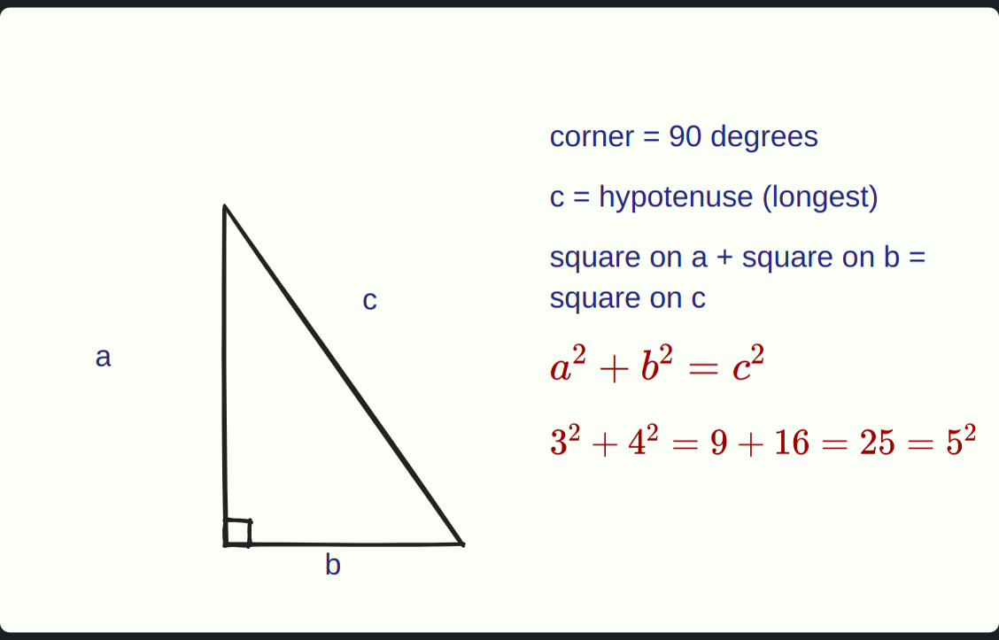

# 🧑‍🏫 AI Whiteboard Tutor

**Press a hotkey. Speak your doubt. An AI tutor explains it — talking and drawing on a live whiteboard, just like a real teacher.**

> _"Bro I don't get this"_ → instant visual explanation, right next to whatever you're studying.

---

## 🎬 Demo



*A real answer from the AI, drawn on the board (not a mock-up). First words play about 1.5 s after you stop talking.*

1. You're watching a YouTube video or reading notes and get stuck  
2. Press **Ctrl+Shift+Space** — say your question out loud  
3. A whiteboard opens beside your screen  
4. The AI **draws and speaks simultaneously** — step by step, like a real tutor at a board  
5. Interrupt anytime with a follow-up — it continues from what's already drawn  

---

## ✨ Key Features

| Feature | What it does |
|---------|-------------|
| 🎤 **Voice In** | Speak naturally — Whisper (via Groq) transcribes in about half a second |
| 🧠 **AI Reasoning** | Cloud AI generates a structured teaching script (diagrams + narration) |
| 🗣️ **Voice Out** | Piper TTS speaks the explanation locally — no internet needed for audio |
| ✏️ **Hand-Drawn Board** | rough.js gives everything a natural, teacher-at-the-board look |
| 📐 **LaTeX Formulas** | KaTeX renders real math — fractions, integrals, chemical equations |
| 📈 **Function Graphs** | JSXGraph plots parabolas, sine waves, linear functions with labeled axes |
| 🔀 **Flowcharts** | Mermaid renders decision trees, cycles (water cycle, algorithms) |
| 💻 **CS Diagrams** | Arrays, linked lists, binary trees, call stacks — all animated |
| 🎯 **Perfect Sync** | Speech and drawing start together; a step ends only when both finish |
| 🔄 **Follow-ups** | Ask a follow-up — the AI sees the current board and continues from there |
| 📋 **Board History** | Every lesson is saved. Replay any past board anytime |
| 🛡️ **Robust** | Malformed AI output is skipped gracefully — the board never crashes |
| 🧒 **Any age** | Kid / Student / Expert picker changes the words, examples and depth |
| 🌍 **Your language** | English, Hinglish, हिन्दी, Español, Deutsch, Français, Italiano — it listens, explains and writes in it |
| 🧠 **Test me** | One tap for a practice question; it checks your answer and explains the mistake |
| 🔁 **Explain differently** | Didn't click? A brand-new analogy and picture, on a clean board |
| 💾 **Save as notes** | Any board saved as PDF + image in Documents/WhiteBoardAI Notes |
| 🖥️ **Lives in your tray** | Tray icon, opens with one hotkey, can start with your computer |
| ✏️ **Draw your doubt** | Sketch a problem on the board and ask about it — the AI reads your drawing |
| ✂️ **Snip** | Drag a box around just the question on your screen you mean |
| 📅 **Revision reminders** | Spaced repetition (1, 3, 7, 21 days): a notification opens the board and quizzes you |
| ♿ **Accessible** | Voice speed, big subtitles, easy-read font |

---

## 🏗️ Architecture

```
┌──────────────────────────────────────────────────────────┐
│                     Electron App                         │
│                                                          │
│  ┌─────────────┐    ┌─────────────┐    ┌──────────────┐  │
│  │  Screenshot  │    │   Whisper   │    │  Piper TTS   │  │
│  │  + Hotkey    │    │   (Groq)    │    │   (local)    │  │
│  └──────┬───────┘    └──────┬──────┘    └──────▲───────┘  │
│         │                   │                  │          │
│         ▼                   ▼                  │          │
│  ┌──────────────────────────────────┐          │          │
│  │        Cloud AI (free tier)      │          │          │
│  │  screenshot + question → script  │          │          │
│  └──────────────┬───────────────────┘          │          │
│                 │ JSON script                  │          │
│                 ▼                              │          │
│  ┌─────────────────────────────────────────────┐         │
│  │            🎨 Whiteboard Engine              │         │
│  │                                              │         │
│  │  rough.js · KaTeX · JSXGraph · Mermaid      │         │
│  │  Animated strokes · Layout engine · History  │         │
│  │                                              │         │
│  │  playStep(step, speak) ──── speak(text) ─────┘         │
│  │  Speech + Drawing run in parallel                      │
│  └────────────────────────────────────────────────────────┘
│                                                          │
└──────────────────────────────────────────────────────────┘
```

---

## 🛠️ Tech Stack

| Layer | Technology | Runs on |
|-------|-----------|---------|
| Desktop app | Electron | Local |
| Speech → Text | Whisper large-v3-turbo (Groq) | Cloud |
| AI Brain | Gemini / Groq (free tier) | Cloud |
| Text → Speech | Piper TTS | CPU |
| Drawing engine | rough.js | Browser |
| Math formulas | KaTeX | Browser |
| Function plots | JSXGraph | Browser |
| Flowcharts | Mermaid | Browser |
| Layout | Custom collision-free placer | Browser |

**Zero cost to run.** All AI calls use free-tier APIs. The voice runs locally on the CPU.

---

## 🚀 Quick Start

### Prerequisites
- Node.js 18+
- Python 3.10+
- Free API keys from [Groq](https://console.groq.com) (and optionally [Google AI Studio](https://aistudio.google.com))

### Setup
```bash
git clone https://github.com/<your-username>/WhiteBoardAI.git
cd WhiteBoardAI

# Shell (Electron + AI + voice)
cd shell
npm install
python3 -m venv .venv && .venv/bin/pip install piper-tts==1.8.0
printf 'GROQ_API_KEY=your-key\nGEMINI_API_KEY=your-key\n' > ../.env   # your free API keys (never committed)

# Download the voice model (~63 MB; other languages: hi_IN-pratham, es_ES-davefx, de_DE-thorsten, fr_FR-siwis, it_IT-paola, same URL pattern)
mkdir -p voices
curl -L -o voices/en_US-lessac-medium.onnx \
  https://huggingface.co/rhasspy/piper-voices/resolve/main/en/en_US/lessac/medium/en_US-lessac-medium.onnx
curl -L -o voices/en_US-lessac-medium.onnx.json \
  https://huggingface.co/rhasspy/piper-voices/resolve/main/en/en_US/lessac/medium/en_US-lessac-medium.onnx.json

# Run
npm start
```

### Try the board standalone (no setup needed)
```bash
# Just open in any browser — everything is vendored
open board/index.html
# Press "Play script" to watch the Pythagoras demo
```

### Run tests
```bash
node --test board/tests/*.test.cjs    # 48 tests, all passing
node --test shell/tests/              # 41 tests, all passing
```

---

## 📁 Project Structure

```
WhiteBoardAI/
├── shared/                  # The contract — both sides agree on this
│   ├── contract.d.ts        # Script, Step, Action types
│   ├── script.schema.json   # JSON Schema for AI output validation
│   └── example-pythagoras.json
├── shell/                   # Pipeline: hotkey → mic → AI → voice
│   ├── main.js              # Electron main process
│   ├── tutor.js             # Conversation state machine
│   ├── llm/callModel.js     # Swappable AI caller (Groq/Gemini)
│   ├── stt/transcribe.js    # Whisper speech-to-text
│   └── tts/piper.js         # Piper text-to-speech
├── board/                   # Whiteboard: drawing + animation + sync
│   ├── board.js             # Core engine (rough.js + KaTeX + history)
│   ├── layout.js            # Collision-free placement
│   ├── cs-helpers.js        # Arrays, linked lists, trees, stacks
│   ├── graph-helpers.js     # Function plots via JSXGraph
│   ├── flow-helpers.js      # Flowcharts via Mermaid
│   └── index.html           # Standalone test page
└── SPEC.md                  # Full specification
```

---

## 🤝 Team

| | Role | Tools |
|---|------|-------|
| **Kabir** | Pipeline — overlay, hotkey, mic, Whisper, AI calls, Piper voice | Claude Code |
| **Aarav** | Whiteboard — drawing engine, animations, formulas, graphs, sync | Codex |

Built in 2 days. Connected through a shared JSON contract so both sides could develop independently.

---

## 📄 License

MIT
